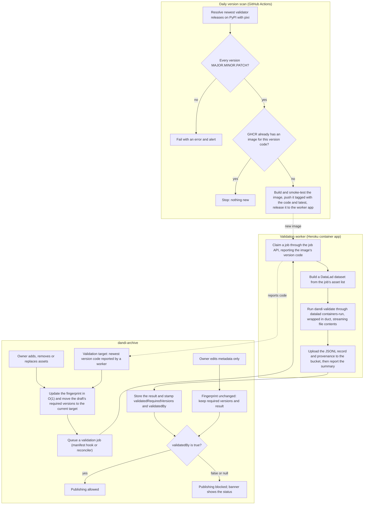

# Trusted File and Dataset Validation

Authors: Cody Baker

Status: proposal

This is the overview of the design. [Trusted File and Dataset Validation: Details](trusted-validation-details.md) specifies each change.

# Contents

- [Terminology](#terminology)
- [Flow](#flow)
- [Overview](#overview)
  - [Goals](#goals)
  - [Summary](#summary)
- [Proposed solution](#proposed-solution)
  - [Publication latency (accepted trade-off)](#publication-latency-accepted-trade-off)
  - [Old files vs. new checks (accepted trade-off)](#old-files-vs-new-checks-accepted-trade-off)
- [Proposed Rollout Order](#proposed-rollout-order)
- [Alternatives to consider](#alternatives-to-consider)
- [Open questions](#open-questions)

# Terminology

- **Validator versions:** the exact version of each package that affects validation results. Keys are plain distribution names, and all six are always present:

  ```json
  {"dandi": "0.75.0", "dandischema": "0.12.0", "nwbinspector": "0.7.1", "pynwb": "3.1.0", "hdmf": "4.1.0", "bids-validator-deno": "2.1.0"}
  ```

- **Version code:** a short, readable string form of validator versions: each package's one-letter code followed by its version, joined by `-`. For the map above: `d0.75.0-s0.12.0-n0.7.1-p3.1.0-h4.1.0-b2.1.0`. It is the validator image's tag and part of each record's path in the bucket (see [Validator versions](trusted-validation-details.md#validator-versions) for the exact format).
- **Validation target:** the version code of the newest released validator image, which tracks the latest validator releases on PyPI (see [Version updates](trusted-validation-details.md#version-updates)).
- **Required versions:** the version code a draft must be validated with: the validation target at the draft's last file change (see [Required versions](trusted-validation-details.md#required-versions)).
- **Content fingerprint:** a hash of the files a version contains, updated in constant time whenever an asset is added, removed or replaced (see [Content fingerprint](trusted-validation-details.md#content-fingerprint)).

# Flow

How a new validator release and a change to a draft's files flow through the system.



# Overview

## Goals

- A Dandiset version cannot be published unless a trusted validation record for its current content contains no errors.
- The record must come from an exact, known set of validator versions:
  - **Drafts:** the latest set the archive was configured for at the draft's last file change (an asset added, removed or replaced). Metadata-only changes don't move it.
  - **Published versions:** the set frozen at publication, which is only possible if the version was valid then, so later validator releases never make them invalid.
- Errors and warnings are shown to everyone in a banner on the Dandiset landing page ([#1486](https://github.com/dandi/dandi-archive/issues/1486)). Warnings do not block publication but reflect overall quality.
- Changes only to the metadata of previously published versions should not trigger version bumps for dataset validation.

## Summary

Today the archive only validates simple asset-level metadata: each Asset's metadata is compared against the `PublishedAsset` schema, and the draft Version's metadata against the `PublishedDandiset` schema.

Neither the archive backend nor any external service runs the validators that check the *contents* of files nor the *layout* of datasets: NWB Inspector, PyNWB validation, BIDS validator, or even the ad-hoc DANDI layout enforced by CLI command `dandi validate`. As a result, Dandisets with invalid NWB files or BIDS/DANDI layouts can be published (e.g. [#2412](https://github.com/dandi/dandi-archive/issues/2412)).

This document proposes running `dandi validate` over every draft Dandiset in a dedicated validation worker: a separate Heroku app that runs a container image. After a draft's asset manifests are written, the archive queues a job, and the worker claims it, builds a DataLad dataset from the version's assets and streams validation through dandi-cli's datalad-fuse support ([dandi/dandi-cli#1955](https://github.com/dandi/dandi-cli/pull/1955), [#1956](https://github.com/dandi/dandi-cli/pull/1956), [#1957](https://github.com/dandi/dandi-cli/pull/1957)). This approach simplifies the majority of modifications that would be required to both the BIDS-Validator and the NWB Inspector to adapt them away from filesystems (even symlinked 'mock' ones as DataLad creates).

- **Results:** each draft Dandisets metadata gets two new fields: the exact validator versions its result must come from (corresponding generally to the 'latest' at time of last asset modification), and whether that result passed or failed (with detailed JSON record of all errors, warnings, etc.). A summary of each result goes in a new table, and the full record goes in the archive bucket.
- **Gating:** the archive blocks publication unless that result has no errors.

The changes in each repository can be summarized as:

| Repository | Change |
|---|---|
| dandi-schema | A `ValidatorType` enum, two read-only `Dandiset` fields, one publication rule, one schema version bump |
| dandi-archive | One table, a small job API for the worker, a scheduler, the worker's container image, a few lines in draft validation and publishing, `/info/` fields, a banner, a daily check |
| dandi-infrastructure | A new Heroku container app for the worker, and config vars on both apps |
| dandi-cli | A release with the streaming stack and small fixes |
| datalad-fuse | A release with the remfile backend, so dandi-cli can depend on it |

# Proposed solution

[Trusted File and Dataset Validation: Details](trusted-validation-details.md) specifies each change. The main decisions are:

- **Gating through the schema.** dandischema gains two read-only `Dandiset` fields: `validatedRequiredVersions` and `validatedBy` (`null` when not run yet, `false` when failed, `true` when passed). Its publication check requires `validatedBy: true` whenever `validatedRequiredVersions` is set, so the archive's existing publish gating blocks publication without a new check in the publish service (see [dandi-schema](trusted-validation-details.md#dandi-schema) and [Stamping](trusted-validation-details.md#stamping)).
- **Only errors block.** Only `ERROR` and `CRITICAL` results block publication. Warnings and hints appear in the banner (see [Validation job](trusted-validation-details.md#validation-job)).
- **An isolated worker.** Validation runs in a separate Heroku app from a container image. The worker holds no database, bucket or Django credentials: it claims jobs through a small job API, reads files through URLs the archive hands out, and uploads records through presigned URLs (see [Validator image](trusted-validation-details.md#validator-image) and [Job API](trusted-validation-details.md#job-api)).
- **Automatic validator updates.** No validator version or image is committed anywhere. A daily scan resolves the newest releases on PyPI, rejects any version that isn't a plain `MAJOR.MINOR.PATCH` release, and builds and releases a new image only when the version code is new. The archive then makes that code its target (see [Version updates](trusted-validation-details.md#version-updates)).
- **Whole-Dandiset runs.** A file's result can depend on other files, so results aren't cached from one job to the next, and every run validates the whole Dandiset (see [No caching across jobs](trusted-validation-details.md#no-caching-across-jobs)).
- **Results tied to content.** Each result is stored with the content fingerprint and version code it was produced for, so a draft is validated again only when its files change. Metadata-only edits keep the result (see [Content fingerprint](trusted-validation-details.md#content-fingerprint) and [Required versions](trusted-validation-details.md#required-versions)).
- **Everything kept.** Each run's summary is a row in a new table, and its full JSONL record and provenance go in the archive bucket. Neither is ever deleted (see [Summary table](trusted-validation-details.md#summary-table) and [Record storage](trusted-validation-details.md#record-storage)).
- **What owners see.** A banner on the landing page shows the status and counts, and the existing validation dialog lists the issues (see [Frontend](trusted-validation-details.md#frontend)).

## Publication latency (accepted trade-off)

After a content change, the owner can publish only once the worker has validated the new content: the queue wait plus a full validation of the Dandiset. Embargoed drafts are validated too, and their record carries over at unembargo because the fingerprint doesn't change, so publishing right after unembargo is not delayed. This delay is accepted in exchange for publishing only validated content.

To notice a stalled worker, a daily email tells developers about every draft that has waited more than three days for a result, and Sentry alerts on errors and on a growing queue (see [Monitoring](trusted-validation-details.md#monitoring)).

## Old files vs. new checks (accepted trade-off)

Once a draft's files change, the whole Dandiset is validated with the latest validation target, so files carried over from earlier releases are re-checked with the latest validators. A small content change, such as adding one file, could therefore be blocked by a check that did not exist when the other files were published. This is accepted, because it means content and structure enhancements go hand-in-hand.

Metadata-only changes are not affected: a draft keeps the validator versions and result from its last file change (see [Required versions](trusted-validation-details.md#required-versions)).

# Proposed Rollout Order

[Rollout details](trusted-validation-details.md#rollout-details) gives the specifics of each step.

1. **dandi-schema:** add `ValidatorType`, the two fields and the publication rule, then bump the version and release.
2. **datalad-fuse:** release with the remfile backend.
3. **dandi-cli:** release with the streaming stack and the fixes the worker needs.
4. **dandi-archive:** ship the archive changes and the daily version scan, with gating off.
5. **dandi-infrastructure:** add the worker app, staging first.
6. **Pilot** on a small, a BIDS and a large Dandiset, to measure cost and choose the worker's dyno size and count.
7. **Shadow mode:** release the first image to the worker app with gating off. Results and the banner appear, but publication is not gated.
8. **Sweep** every draft, either on the worker app scaled up temporarily, or with the same image elsewhere, for example with Apptainer on HPC near the bucket.
9. **Review:** when the majority of records are available, review them for accuracy and summarize potential effects and performance.
10. **Turn gating on.**

# Alternatives to consider

- **A dedicated publish check in the archive instead of a schema rule.** This would need changes to `Version.publishable` and `_lock_dandiset_for_publishing`, a new exception, and frontend gating, all of which the schema rule reuses. The schema rule also makes the requirement visible to anyone validating DANDI metadata.
- **An external trusted runner (the previous design).** A runner on separate compute would validate the `dandisets/` DataLad clones and push summaries through a staff-only endpoint. It was not chosen because the backup lag adds publication latency and it cannot read embargoed content. The chosen design keeps its isolation, but takes its inputs from the archive.
- **Validators inside the archive app.** Running the validators as a subprocess on a worker dyno of the archive's own app avoids a second app and the job API. But that dyno holds the database, bucket and Django credentials, and it must carry every validator environment.
- **Store full records in the archive database.** They are large, and it would tie the archive to dandi-cli's record model, which rejects unknown enum values.
- **A richer provenance object**, e.g. a `ValidationActivity(Activity)` with `Software` entries in `wasAssociatedWith`, mirroring `publishedBy: PublishActivity`. It is more expressive, but the map and boolean are simpler to look up and to enforce in `check_publication_status`.

# Open questions

1. **Worker size and sweep budget.** Which dyno size and count, and where should the initial sweep run (the worker app scaled up, or the same image elsewhere)? To be decided from the pilot.
2. **Retry thresholds.** How many retries, and how much backoff, before a run is marked failed?
3. **Zarr.** Every asset should be NWB or BIDS, and either can be stored as Zarr. Zarr-backed assets are reported as "not checked" for now. Should validation include them?
