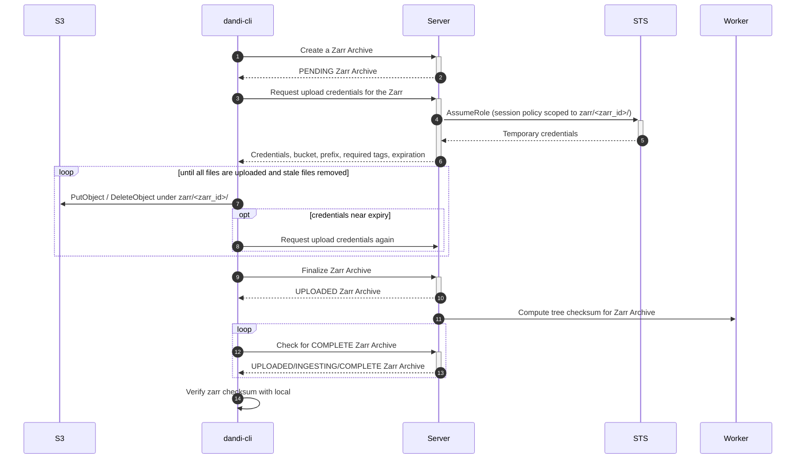

# Zarr Upload via Temporary S3 Credentials

Status: draft

This document proposes replacing the per-file presigned URL flow for Zarr uploads
with temporary AWS credentials, minted by the API through STS, that allow a
client to write and delete objects directly under a single Zarr's S3 prefix
(`zarr/<zarr_id>/`) and nowhere else.

## Background

The current flow is described in [Zarr Upload Process Simplification](./zarr-performance-redesign.md).
Every object the client writes or removes still goes through the API:

- **Upload**: `POST /zarr/{zarr_id}/files/` with up to 255 `{path, base64md5}`
  entries returns one presigned `PUT` URL per entry. Each call takes a row lock
  on the Zarr, signs every URL, and writes an audit record containing every path.
- **Delete**: `DELETE /zarr/{zarr_id}/files/` makes the API server issue a `HEAD`
  and then a `DELETE` to S3 for each path, serially, inside the request (and
  inside a transaction holding the Zarr row lock).

For a Zarr with millions of chunks this is thousands of API round trips whose
only purpose is to hand out permission to touch one key at a time. The API is a
bottleneck for upload throughput, and Zarr uploads compete with all other API
traffic for web dynos.

The permission the client needs is simple to state: *write and delete anything
under this Zarr's prefix, for a limited time*. STS can express exactly that.

## Proposed Process



Creation, finalization, ingestion, and the client-side checksum comparison are
unchanged. Only the middle of the process changes: one API call replaces
all of the per-batch calls.

## API

### `POST /api/zarr/{zarr_id}/credentials/`

No request body. The checks are the same as today's `POST /zarr/{zarr_id}/files/`:

- The caller must be an owner of the Zarr's dandiset (`403` otherwise).
- The Zarr must not be `UPLOADED` or `INGESTING` (`400` otherwise).
- New: the dandiset must not have an unembargo in progress (`400`), see [Embargo](#embargo).
- New: the deployment must have an upload role configured (`501` otherwise), so
  that the application can be deployed before the infrastructure exists.

On success the Zarr is marked `PENDING` (checksum, size, and file count are
reset, exactly as `create_files` does today), an audit record is written, and
the response is:

```json
{
  "credentials": {
    "access_key_id": "ASIA...",
    "secret_access_key": "...",
    "session_token": "...",
    "expiration": "2026-11-12T22:00:00Z"
  },
  "bucket": "dandiarchive",
  "prefix": "zarr/5ab8a7d5-3e0c-4b0e-9a37-0d8f6a2b9d11/",
  "region": "us-east-2",
  "endpoint_url": null,
  "object_tags": {"embargoed": "true"}
}
```

- `endpoint_url` is `null` on AWS and set for S3-compatible deployments (MinIO).
- `object_tags` are tags the client **must** send (as `x-amz-tagging`) on every
  `PutObject`. It is `{}` for a Zarr in an open dandiset, in which case the
  client must not send an `embargoed` tag at all. S3 rejects requests that
  break either rule.

The endpoint may be called any number of times; each call returns an
independent set of credentials. This is how a long upload refreshes them.

### Existing endpoints

`POST` and `DELETE /zarr/{zarr_id}/files/` remain in place and unchanged while
clients migrate. `GET /zarr/{zarr_id}/files/` (listing) is unaffected and remains
how a client discovers what is already uploaded. Removing the old write endpoints
is a later, separate step (see [Open questions](#open-questions)).

## Credential scope

Credentials come from `sts:AssumeRole` on a dedicated upload role, with an
inline session policy generated per request:

```json
{
  "Version": "2012-10-17",
  "Statement": [
    {
      "Effect": "Allow",
      "Action": ["s3:PutObject", "s3:PutObjectTagging"],
      "Resource": "arn:aws:s3:::<bucket>/zarr/<zarr_id>/*",
      "Condition": {
        "StringEquals": {"s3:RequestObjectTag/embargoed": "true"}
      }
    },
    {
      "Effect": "Allow",
      "Action": "s3:DeleteObject",
      "Resource": "arn:aws:s3:::<bucket>/zarr/<zarr_id>/*"
    }
  ]
}
```

The policy shown is for an embargoed Zarr. S3 requires `s3:PutObjectTagging`
in addition to `s3:PutObject` for an upload that sets tags, so both are granted,
and both only when the request sets `embargoed=true`. That also permits the
standalone tagging call, but only to set `embargoed=true` again; removing the
tag needs `s3:DeleteObjectTagging`, which is not granted.

For an open Zarr the first statement grants `s3:PutObject` alone, with the
condition `{"Null": {"s3:RequestObjectTag/embargoed": "true"}}`. An owner
therefore cannot tag objects in an open dandiset as embargoed and make them
publicly unreadable.

What the session can and cannot do:

| Operation | Result |
| --- | --- |
| `PutObject` under its own prefix, correctly tagged | allowed |
| `DeleteObject` under its own prefix | allowed (creates a delete marker; the bucket is versioned) |
| Anything under another Zarr's prefix, `blobs/`, `dandisets/` | denied |
| Changing or removing the `embargoed` tag on an existing object | denied |
| `GetObject`, `ListBucket`, `PutObjectAcl` | not granted by the session |
| `DeleteObjectVersion` | not granted, and already denied for everyone by the bucket policy |

- **Duration**: 1 hour by default (setting), clients refresh. `AssumeRole`
  allows 15 minutes to 12 hours, bounded by the role's `MaxSessionDuration`.
- **Session name**: `u<user_id>-z<zarr_id>` (fits the 64 character limit). It
  appears as the requester in S3 server access logs, which are already enabled
  on the bucket, so every object write and delete remains attributable to a user.
- **Policy size**: the inline policy is about 400 characters against a 2,048
  character limit.

### Why `AssumeRole` rather than `GetFederationToken`

Both can be called with the API's existing IAM user credentials.

- **Hard ceiling outside application code.** The API's IAM user has `s3:*` on
  the bucket. With `GetFederationToken` the session policy is the only thing
  narrowing that, so a bug in policy generation could hand out broad access.
  With a role, the role's own policy (put, tag, and delete on `zarr/*`) is a
  ceiling that the application cannot exceed.
- **Revocation.** All outstanding sessions of a role can be revoked at once by
  attaching a deny on `aws:TokenIssueTime`. Presigned URLs and federation tokens
  are tied to the API user's long-lived key and can only be revoked by rotating it.
- **Development parity.** MinIO implements `AssumeRole` with inline policies but
  not `GetFederationToken`.
- **Cost.** One extra IAM role per bucket, and a 12 hour maximum instead of 36.

## What the server no longer controls

With presigned URLs the server chose the key, pinned the `Content-MD5`, and
forced a single-part `PUT`. With credentials the client drives S3 directly, so
these guarantees have to be re-established elsewhere.

**Integrity.** Unchanged in effect. The Zarr checksum is built from each
object's ETag, the client compares the server-computed checksum with its
locally computed one, and a mismatch means something is missing or corrupt.
Clients should still send `Content-MD5` so that S3 rejects a corrupted transfer
immediately.

**Multipart uploads.** `s3:PutObject` also authorizes multipart uploads, and
IAM has no condition to forbid them. A multipart object's ETag is not its MD5,
which would silently produce a non-canonical Zarr checksum. Note that boto3's
`upload_file` switches to multipart at 8 MB by default. Therefore:

- The client contract is single-part `PutObject` only (5 GB limit, as today).
- Ingestion must reject any object whose ETag is not a plain 32 character hex MD5.
- A lifecycle rule should abort incomplete multipart uploads under `zarr/`
  (none exists today).

**Key hygiene.** IAM matches the literal key, so a `..` segment cannot escape
the prefix on S3. It can, however, now exist as a literal object key, and
server code that later normalizes paths (`clean_name` in the listing, download,
and delete paths) would mishandle it. Ingestion must reject keys that fail
`validate_zarr_path` or contain empty segments.

**Writes after finalize.** Credentials stay valid until they expire, including
after the client calls finalize, so a client can modify a Zarr during or after
ingestion and leave the recorded checksum stale. This is not new: presigned URLs
are valid for 6 hours in production today. A 1 hour default narrows the window
rather than widening it. Closing it entirely is discussed under
[Open questions](#open-questions).

**Audit.** `upload_zarr_chunks` and `delete_zarr_chunks` records list every
path. The server no longer sees paths, so the new flow writes a single
`issue_zarr_credentials` record per call (user, Zarr, expiration). Per-object
history moves to the S3 access logs, keyed by session name.

## Embargo

- For a Zarr in an embargoed dandiset, the session policy only allows
  `PutObject` when the request carries `embargoed=true`, replacing the tag that
  is baked into presigned URLs today.
- The bucket policy's embargo `Deny` is conditioned on `s3:ExistingObjectTag`,
  which S3 documents as unsupported for the `PUT Object` and `DELETE Object`
  operations. It should therefore not block the upload role from overwriting or
  deleting embargoed objects. Whether that holds for the `s3:PutObjectTagging`
  check made as part of a tagged overwrite is not stated in the documentation
  and must be confirmed on the sandbox bucket. If the overwrite is denied, the
  upload role has to be exempted from that statement, paired with a second
  `Deny` that keeps it away from every action other than its own three.
- Credentials are not issued while an unembargo is in progress. Credentials
  issued shortly before an unembargo could still write `embargoed=true` objects
  after tags are removed, for at most one credential lifetime. The same race
  exists with presigned URLs today, with a 6 hour window.

## Infrastructure changes

In `dandi-infrastructure`, per bucket (`modules/dandiset_bucket`):

1. An IAM role in the project account whose trust policy allows the bucket's
   API IAM user to assume it, with `max_session_duration` set explicitly.
2. A role policy allowing `s3:PutObject`, `s3:PutObjectTagging`, and
   `s3:DeleteObject` on `<bucket>/zarr/*`.
3. A bucket policy statement granting the same three actions on `zarr/*` to the
   role. This is required for the production bucket, which lives in the
   sponsored account (cross-account access needs both sides to allow), and is
   harmless for the sandbox bucket.

Neither static policy mentions an individual Zarr or the embargo tag. They
bound the role to the Zarr prefix as a whole; the per-request session policy
narrows a session to one Zarr and sets the tag rule. A request succeeds only if
all three allow it.
4. A lifecycle rule aborting incomplete multipart uploads under `zarr/`.
5. A new config var with the role ARN for each Heroku app.

## Application changes

In `dandi-archive`:

- Settings: `DANDI_ZARR_UPLOAD_ROLE_ARN` and
  `DANDI_ZARR_UPLOAD_CREDENTIALS_DURATION` (default 3600).
- `DandiS3Storage`: a method that builds the session policy and calls
  `AssumeRole`. `MinioDandiS3Storage` reports its media URL as `endpoint_url`.
- `ZarrViewSet`: the `credentials` action described above.
- Audit: the `issue_zarr_credentials` record type (requires a migration, since
  record types are model choices).
- Ingestion: validate ETags and keys while listing, before computing the checksum.
- `/api/info/`: advertise the capability so clients can choose a flow without probing.

In `dandi-cli` (separate work): use the credentials with an S3 client, obey
`object_tags`, use single-part puts with `Content-MD5`, refresh before
`expiration`, and batch deletes with `DeleteObjects`. boto3 is currently only an
optional dependency of dandi-cli.

## Local development and testing

The MinIO image used by `docker-compose.yml` (release 2025-05-24) was checked
against this design, using the existing root credentials and no extra
configuration:

- `AssumeRole` with an inline policy succeeds (`RoleArn` is ignored).
- Prefix scoping is enforced for both `PutObject` and `DeleteObject`.
- Both tag conditions (`StringEquals` and `Null` on
  `s3:RequestObjectTag/embargoed`) are enforced.
- With the embargoed policy, the `embargoed` tag on an existing object cannot
  be changed or removed.
- `GetObject` and `ListBucket` are denied.

The test suite can therefore exercise real enforcement rather than mocking STS.
Two differences from S3:

- MinIO rejects keys containing `..` outright, whereas S3 accepts them, so the
  ingestion key check needs a test that does not depend on MinIO refusing the
  upload.
- MinIO authorizes a tagged upload with `s3:PutObject` alone, whereas S3 also
  requires `s3:PutObjectTagging`. A policy that is missing that action passes
  locally and fails on AWS.

Not yet verified against real AWS, and to be tried on the sandbox bucket before
the application work is merged:

- The cross-account combination of role policy, session policy, and bucket
  policy on the sponsored bucket.
- A tagged overwrite of an existing embargoed object by the upload role (see
  [Embargo](#embargo)).

## Open questions

1. **Ingestion failure.** Rejecting a multipart ETag or an invalid key needs
   somewhere to go, and `ZarrArchiveStatus` has no failure state. Options:
   return the Zarr to `PENDING` and record an error message on it, or add a
   `FAILED` status. The first is the smaller change.
2. **Writes after finalize.** Accept the bounded window (proposed), or record
   the latest credential expiration on the Zarr and have finalize defer
   ingestion until it has passed. The second closes the window but makes
   finalize wait up to one credential lifetime unless the duration is short.
3. **Old endpoints.** How long `POST`/`DELETE /zarr/{zarr_id}/files/` stay, and
   whether the minimum dandi-cli version in `/api/info/` is bumped to retire them.
4. **Audit detail.** Whether credential-level audit records plus S3 access logs
   are an acceptable replacement for per-path audit records.
5. **Credential lifetime.** 1 hour with refresh (proposed) versus a longer
   lifetime that most uploads never need to refresh.
